<p align="center">
  <picture>
    <source media="(prefers-color-scheme: dark)" srcset="docs/media/banner-dark.png">
    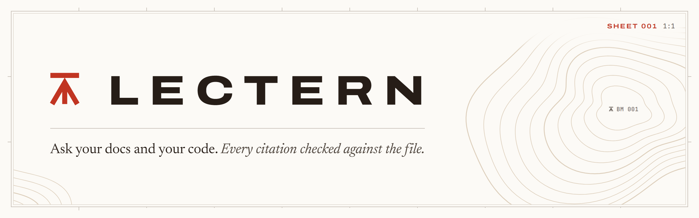
  </picture>
</p>

<p align="center">
  A local notebook for developers. Pin the docs you trust, point it at your source folders, ask questions,<br>
  and every citation in the answer gets checked against the actual file before you see it.
</p>

<p align="center">
  <a href="#quick-start">Quick start</a> ·
  <a href="#your-first-notebook">First notebook</a> ·
  <a href="#how-a-citation-gets-checked">How it checks</a> ·
  <a href="#demos">Demos</a> ·
  <a href="#settings">Settings</a> ·
  <a href="#use-it-from-claude-code-or-cursor-mcp">MCP</a> ·
  <a href="#cli">CLI</a> ·
  <a href="CHANGELOG.md">Changelog</a>
</p>

<p align="center">
  <a href="https://github.com/DizzyMii/lectern/actions/workflows/ci.yml"></a>
  
  
  
</p>

<p align="center">
  <picture>
    <source media="(prefers-color-scheme: dark)" srcset="docs/media/hero-dark.png">
    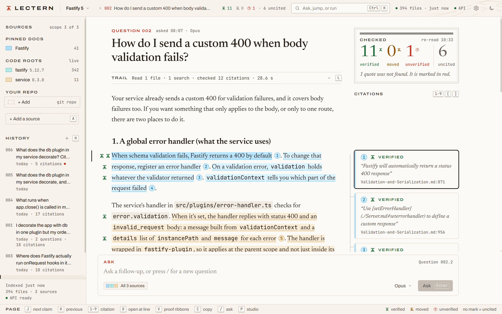
  </picture>
</p>

<p align="center">
  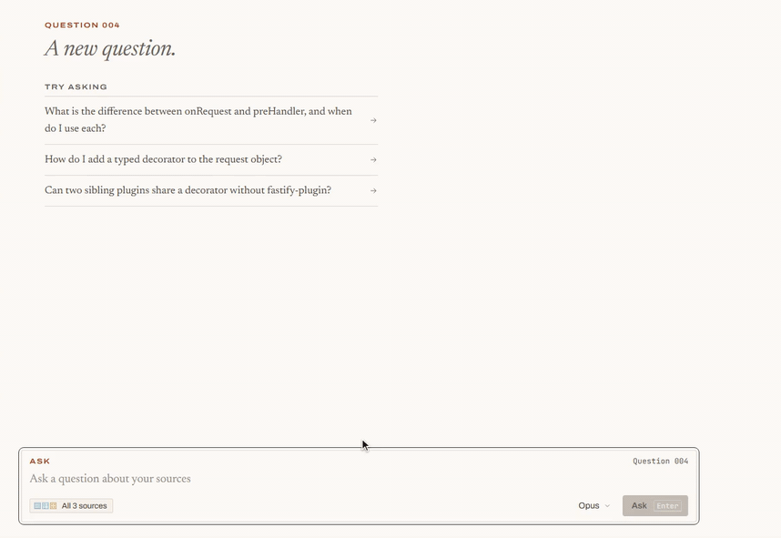<br>
  <sub>One real ask. It took about 40 seconds and the clip runs 18: the waiting is sped up (8x while it reads files, 5x while the answer streams), the checking at the end runs at real speed. <a href="docs/media/ask.mp4">Full quality (MP4)</a></sub>
</p>

## Quick start

Pick one.

### Desktop app (Windows)

```
git clone https://github.com/DizzyMii/lectern.git
cd lectern
npm install
npm run build:exe
```

That leaves two files in `dist/`:

| File | What it is |
|---|---|
| `Lectern Setup.exe` | Installs for your user, no admin needed. Starts in a couple of seconds. This is the one to hand to people. |
| `Lectern.exe` | Portable, runs from anywhere. It unpacks itself on every launch so it takes about 30 seconds to open. |

Neither needs Node on the machine it runs on. Neither is code signed yet either, so SmartScreen asks the first time (More info, Run anyway).

Closing the window leaves Lectern in the system tray (the Quit when the window closes switch in Settings turns that off). While it sits there it watches your code roots, and after a git pull or a save moves the citations in a saved answer you get a notification with the question number, click it to land on that answer.

Quick ask is off until you switch it on in Settings. With it on, <kbd>Ctrl</kbd>+<kbd>Alt</kbd>+<kbd>Space</kbd> in any app opens a small Lectern window with your clipboard text already in the palette. <kbd>Enter</kbd> asks your last-used notebook on the fast preset (Haiku, low effort), and <kbd>Alt</kbd>+<kbd>Enter</kbd> opens that question in the main window. Clipboard text is cut at 8,000 characters.

### npm

Needs Node 20 or newer.

```
npm install -g @dizzymii/lectern
lectern serve --open
```

`npx @dizzymii/lectern serve` works too if you don't want it installed. Either way it's on http://127.0.0.1:4317.

### From a clone

```
npm install
npm start        # the web app on http://127.0.0.1:4317
npm run app      # the same thing in the desktop window
```

[docs/SETUP.md](docs/SETUP.md) walks through a fresh machine step by step, including phone access over Tailscale and starting it at logon.

## Your first notebook

1. **Add an API key.** Click the cog in the top bar, paste a key from [console.anthropic.com](https://console.anthropic.com), Save. The engine label next to it turns green.
2. **Make a notebook.** First run walks you through it, or try the ready-made one:
   ```
   lectern example node-docs
   ```
   That pulls three pages of the Node.js 22 API docs into a new notebook.
3. **Add sources.** Press <kbd>A</kbd>. A page URL gets pinned as markdown, a folder or git repo becomes a code root the model can search.
4. **Ask.** Press <kbd>/</kbd>, type, <kbd>Enter</kbd>. Click any `[n]` to open the file at that line.

## What it does that NotebookLM doesn't

- **Code roots.** A notebook holds pinned docs (the shelf) plus code roots, which are folders or git repos on your disk. The model can search and read any text file under a root while it answers, so it quotes the real source of the library you're using.
- **Checked citations.** Every `[n]` points at a file and a line range, and Lectern checks the quote is really there. Code citations save the lines they cite and compare them again on every re-check. Each one comes back verified, moved (found elsewhere in the file, with the new line), unverified (the quote is gone, or the saved code lines were rewritten) or missing, and they get re-checked whenever you open an old conversation, so if the docs or the code changed under you, it shows.
- **Studio.** 24 recipes that turn a notebook into a saved artifact (specs, code maps, a CLAUDE.md, flashcards, a diff review...) with the same citation checks.
- **MCP.** `lectern mcp` lets Claude Code or Cursor search your notebook for free and ask it questions while they work.

It all runs on your machine. The server only listens on 127.0.0.1.

## How a citation gets checked

Behind every `[n]` is a file plus a short verbatim quote, a line range or both (docs mostly get a quote, code gets line numbers). A line-only citation also saves a copy of the lines it points at when the answer is saved. Lectern opens the file as it is on disk right now and looks, and does it again every time you open an old conversation.

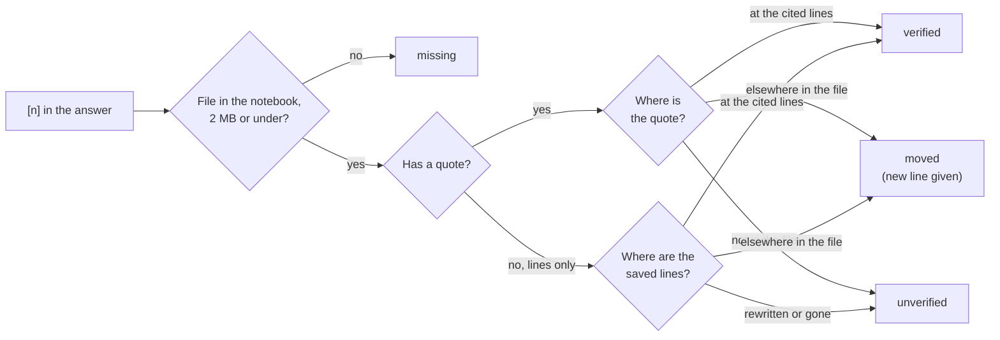

| Status | Means |
|---|---|
| **verified** | The quote is within two lines of the cited range (anywhere in the file if no range was given), or the saved lines are still at the cited range. Whitespace and blank lines don't count as a change. |
| **moved** | The quote or the saved lines are in the file at different lines. The card says where, like "Cited L9, found at L15". |
| **unverified** | The quote isn't in the file, or the saved lines were rewritten. The hover card shows the saved lines over today's with the changed words marked. |
| **missing** | No such file inside the notebook or its code roots, or it's over 2 MB. |

Each answer also records the git commit of every code root it read. When a code citation drifts, <kbd>E</kbd> in the drawer shows the file as it was beside today's version, and <kbd>D</kbd> lists the commits since then that touched those lines. Answers saved before Lectern kept these copies get one the first time they're re-checked, and the card says so.

<p align="center">
  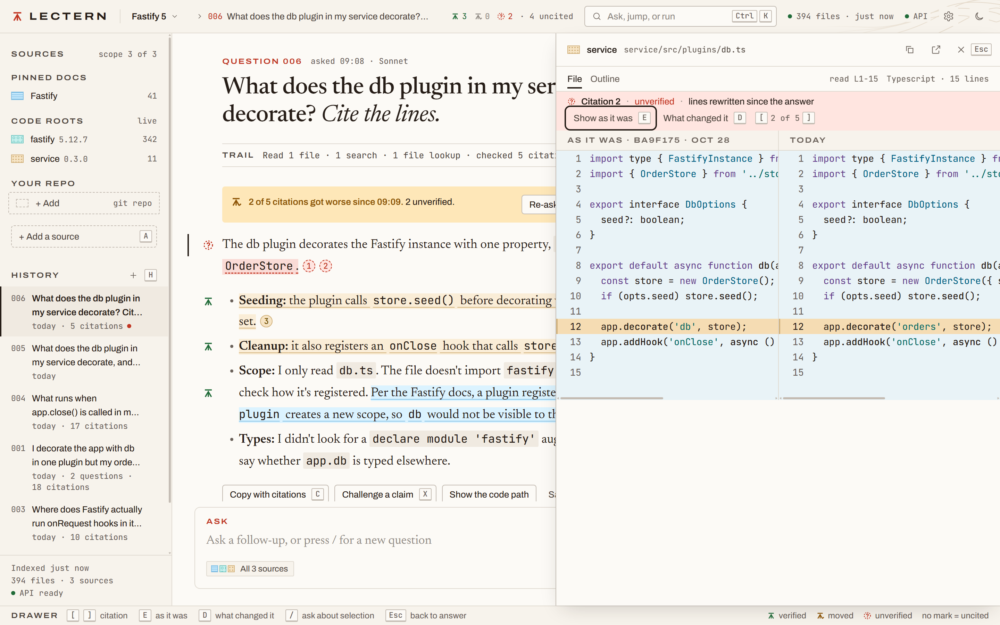<br>
  <sub>Question 006 (what the db plugin decorates) after two lines of <code>db.ts</code> were edited, the store now takes options and the decorator is called <code>orders</code>. Citation 2 cited line 12 and is now unverified ("lines rewritten since the answer"). <kbd>E</kbd> puts the file as it was at commit <code>ba9f175</code> beside today's, with the cited line banded on both sides.</sub>
</p>

## Demos

Every clip is the web UI on one notebook: the Fastify docs pinned (41 files), with the Fastify 5.12.7 source and an 11-file orders service as code roots. Each caption links the MP4 if the GIF is too soft.

### Walk the claims, open the source

<p align="center">
  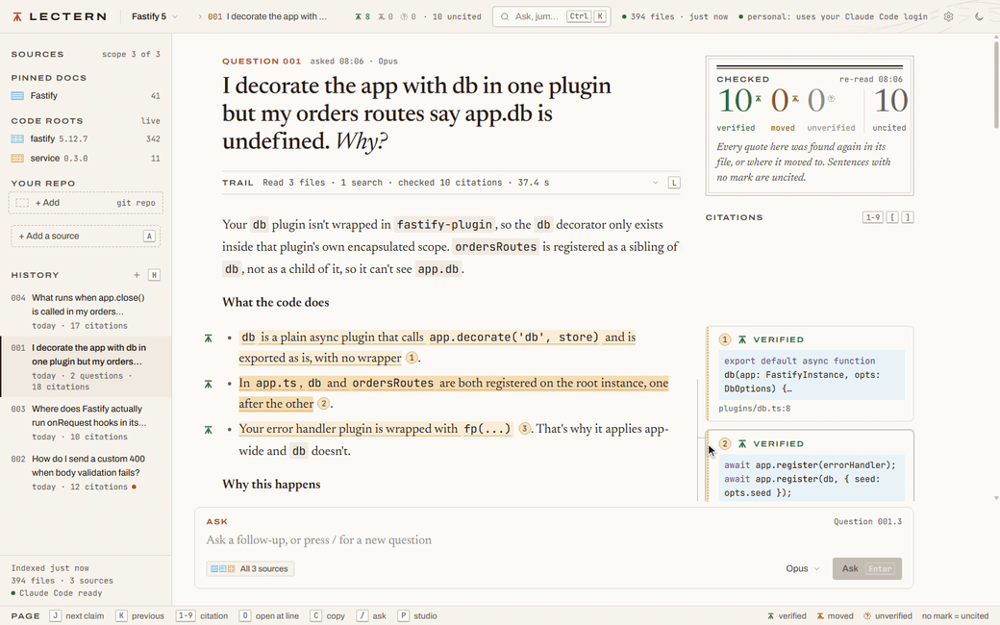
</p>

<kbd>J</kbd> / <kbd>K</kbd> move the claim cursor and the matching margin card lights up. Hover a citation for the excerpt, <kbd>O</kbd> opens the drawer at the cited lines (here `service/src/app.ts` 14 to 16), <kbd>]</kbd> steps to the next one. [Full quality (MP4)](docs/media/citations.mp4)

### Proof ribbons

<p align="center">
  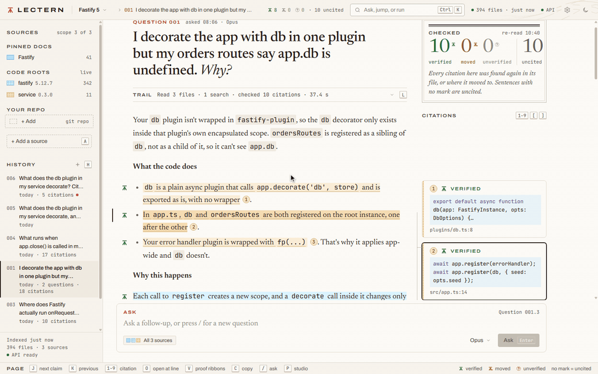
</p>

<kbd>V</kbd> on the `app.db` answer from the top of the page widens the margin and turns every citation card into an excerpt of its file, with a ribbon from each claim to its lines. <kbd>J</kbd>, <kbd>J</kbd>, <kbd>K</kbd> move the cursor and the ribbons for the other claims thin out, <kbd>Esc</kbd> puts the margin back. [Full quality (MP4)](docs/media/proof.mp4)

### When the files change under an answer

<p align="center">
  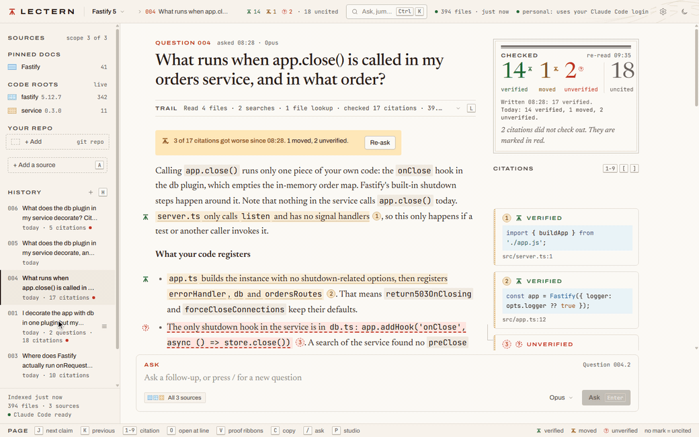
</p>

`db.ts` got shorter and `Plugins.md` grew four lines at the top. The clip opens on the `app.close()` answer (its banner already says 3 of 17 citations got worse), then reopens the `app.db` answer from history. Its receipt now has a Written line (08:06, 10 verified) over a Today line (5 verified, 4 moved, 1 unverified), the changed marks stamp in, and the `Plugins.md` mark rolls from L9 to L13. Hovering citation 1 shows Saved L8-14 over Now L8-11 with the changed words marked, and the History row lists the earlier checks. The banner reads 5 of 10 citations got worse since 08:06. [Full quality (MP4)](docs/media/drift-replay.mp4)

### Where a file is cited from

<p align="center">
  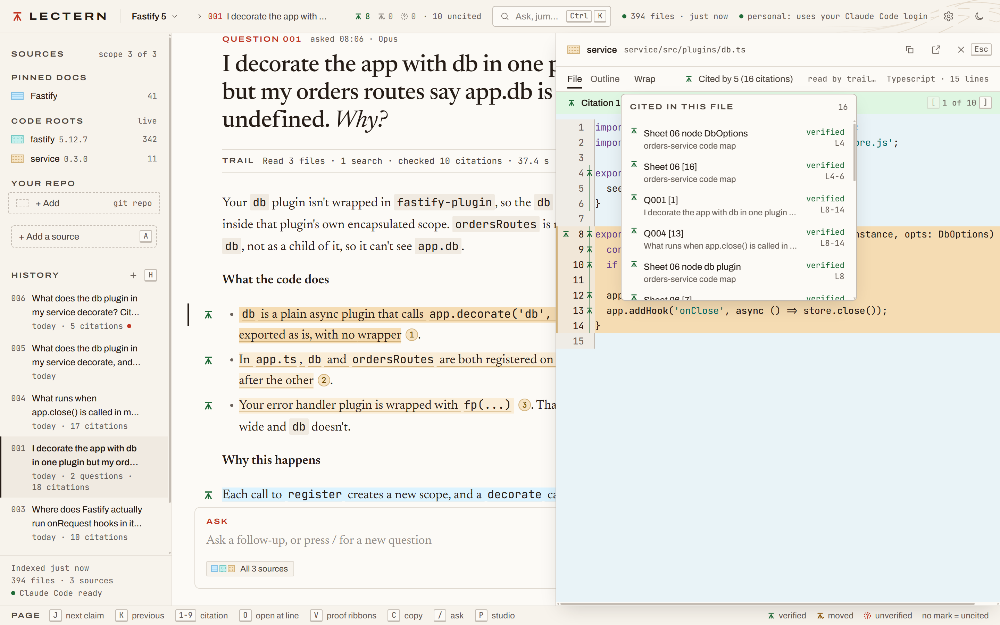
</p>

`db.ts` in the drawer. Every line something cites is marked in the gutter, with the status glyph where a cited range starts (lines 4, 8, 9, 10, 12 and 13) and a stem down the rest of the range. Cited by 5 (16 citations) in the header opens the list: the orders-service code map, the flashcards sheet and questions 001, 004 and 006, each row with its status and lines.

### What the trail read

<p align="center">
  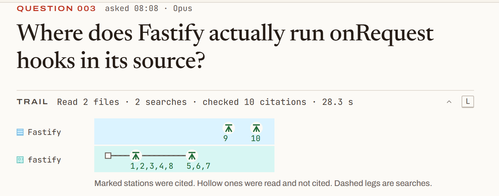
</p>

<kbd>L</kbd> opens the trail on the `onRequest` answer with the map on top, one row per source. On the fastify row (the code root) the square is `fastify/lib`, grepped twice, first for `onRequest` and then for `hookIterator` and `runPreParsing`, and the line runs on to `route.js` (read at lines 490 to 619) and `hooks.js` (read at lines 225 to 284). Citations 1, 2, 3, 4 and 8 are in `route.js` and 5, 6 and 7 in `hooks.js` (7 and 8 sit further down than the reads went, the second grep found them). The two marks on the Fastify row (the pinned docs) are `Lifecycle.md` and `Hooks.md`, cited as 9 and 10.

### Studio

<p align="center">
  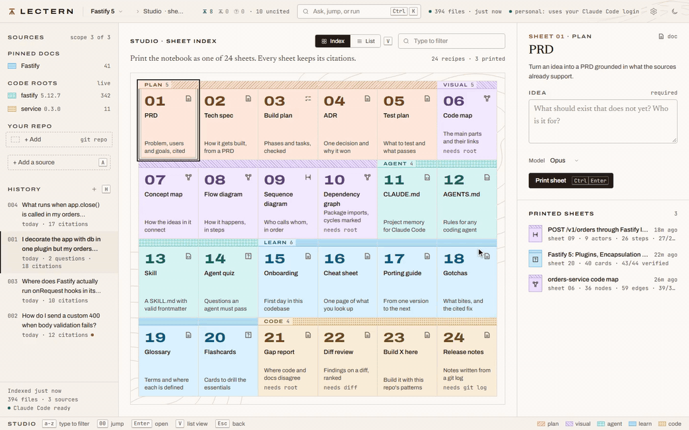
</p>

<kbd>P</kbd> opens the sheet index (24 recipes, 3 printed in this notebook). The code map has 39 verified citations and 36 nodes, search finds the db plugin node, and Open at line drops you in `db.ts` at line 8. [Full quality (MP4)](docs/media/studio.mp4)

<table>
  <tr>
    <td width="50%" valign="top">
      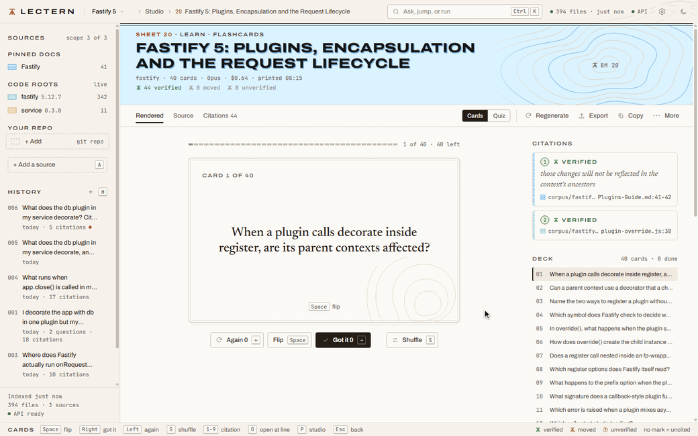
      <br><sub>Flashcards on plugins and encapsulation, 40 cards with 44 verified citations. Flip, then Got it or Again, and hover a citation to see the quote. <a href="docs/media/flashcards.mp4">Full quality (MP4)</a></sub>
    </td>
    <td width="50%" valign="top">
      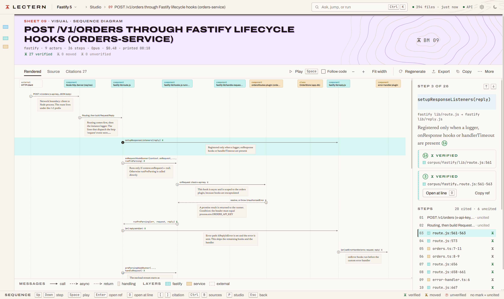
      <br><sub>Sequence diagram of <code>POST /v1/orders</code> through Fastify's lifecycle hooks: 9 actors, 26 steps, 27 verified citations. Step 3 is selected and shows its two.</sub>
    </td>
  </tr>
</table>

<p align="center">
  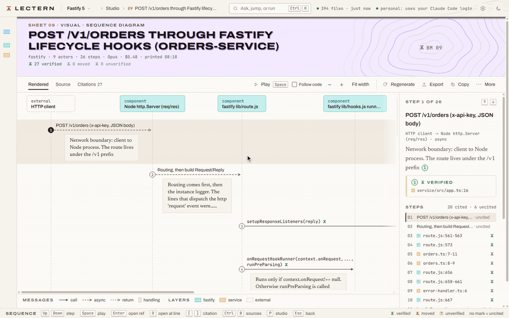
</p>

The same sequence sheet with Follow code ticked. Play starts at step 1, a packet runs along the first arrows, and then the drawer follows each cited step: `route.js` 561 and 573, `orders.ts` 7 and 8, `route.js` 656 and 658. <kbd>Esc</kbd> stops it. At this window width the drawer covers the right-hand lanes. [Full quality (MP4)](docs/media/sequence-play.mp4)

### Asked before

<p align="center">
  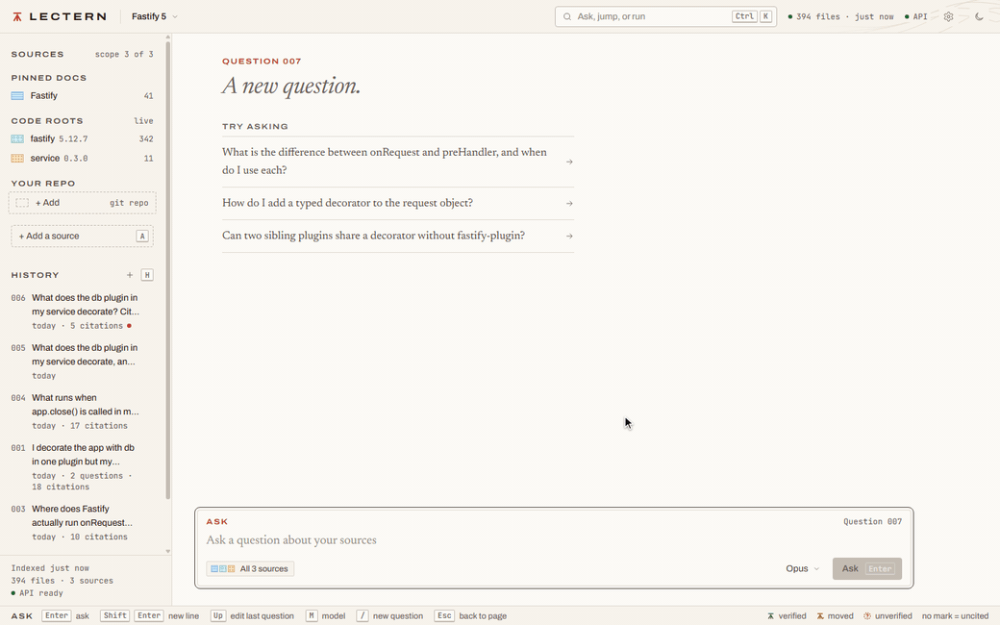
</p>

Type "Why is app.db undefined in my orders routes after I decorate it in one plugin?" into a new question and a hint shows up under the text: Asked before, Question 001, 10 citations, all still verified. <kbd>Tab</kbd> lands on its Open button (<kbd>Enter</kbd> there would open Question 001). Nothing gets submitted in the clip. [Full quality (MP4)](docs/media/recall.mp4)

### Command palette

<p align="center">
  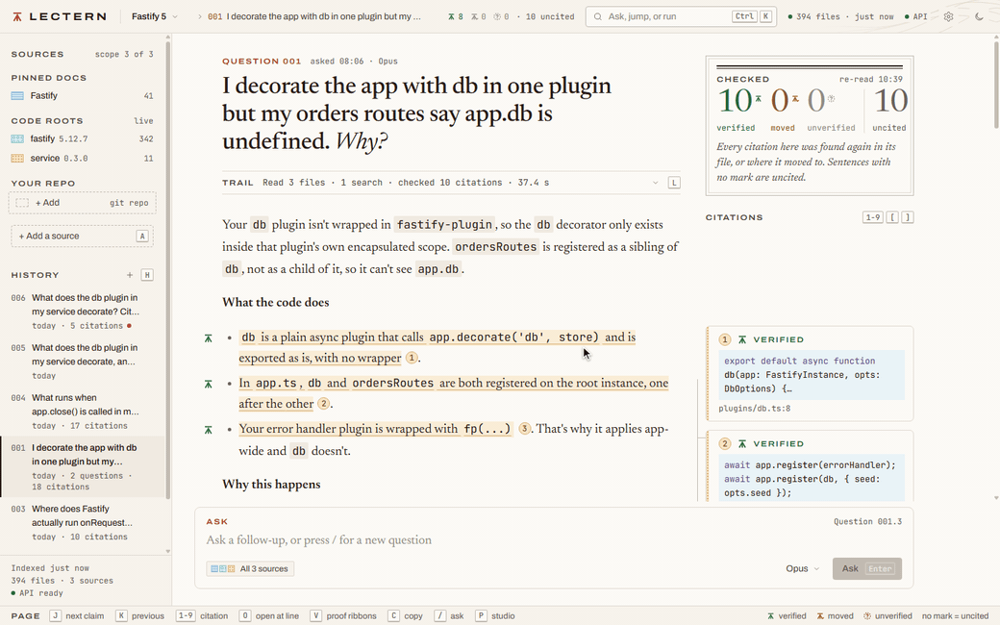
</p>

<kbd>Ctrl</kbd>+<kbd>K</kbd>, type `orders`, and files, questions and sheets filter as you type. Four <kbd>Down</kbd> presses and <kbd>Enter</kbd> open `orders-store.ts` in the drawer. [Full quality (MP4)](docs/media/palette.mp4)

## How well it works

Measured on one notebook (NeoForge 1.21.1: 18 docs, 68 files, 3 code roots, about 350k tokens of pinned shelf). Yours will be different.

| | Result |
|---|---|
| 5 graded questions | 53 of 53 citations verified, 17.5 of 21 key facts |
| Fast ask through MCP | about 2 cents, 8 seconds |
| Deep ask | about 43 cents, 30 seconds |
| New conversation on Opus, shelf cached | about 30 cents |
| Cold shelf load | about $3 |

> [!WARNING]
> That $3 is the one to watch. The first ask per notebook and model loads the whole shelf into the cache and pays for it, after that it stays warm as long as you ask something within the hour (on the API engine that's a one-hour cache entry, which costs 2x input to write and a twentieth to read). Use fast mode (Haiku) for the "where is X" kind of lookups.

## Settings

The cog in the top bar (or the engine label, or `Settings` in the <kbd>Ctrl</kbd>+<kbd>K</kbd> palette). Everything saves to `settings.json` in the home folder and applies straight away, except the two marked restart.

| Setting | Env var | What it's for |
|---|---|---|
| Anthropic API key | `ANTHROPIC_API_KEY` | What Lectern answers with. Only ever shown back as its last four characters. |
| Workspace id | `ANTHROPIC_WORKSPACE_ID` | Only for a key made outside a workspace (starts with `wrkspc_`). Without it those keys get a 400. |
| Claude Code binary | `CLAUDE_BIN` | Path to `claude` when it isn't on PATH. Restart. |
| Projects folder | `LECTERN_PROJECTS_DIR` | Where the first-run screen looks for projects. Your home folder when empty. |
| Clone size cap (MB) | `LECTERN_CLONE_MAX_MB` | A git checkout over this gets deleted again. 1024 when empty. |
| Allow private URLs | `LECTERN_ALLOW_PRIVATE_URLS` | Lets Add URL fetch intranet and localhost pages. |
| Port | `PORT` | 4317 when empty. Restart. |
| Use my Claude Code login | `LECTERN_PREFER_CLAUDE_CODE` | Off by default. Answers questions asked on this machine through the `claude` you're already signed in to, on your own account. Questions from another device use the API key. |
| Quit when the window closes | `LECTERN_QUIT_ON_CLOSE` | Desktop app. Off means closing the window leaves Lectern in the tray, watching your code roots. |
| Quick ask hotkey | `LECTERN_QUICK_ASK` | Desktop app. <kbd>Ctrl</kbd>+<kbd>Alt</kbd>+<kbd>Space</kbd> from any app. Off by default because another app may already own that shortcut. |

Each one is also an environment variable, and a value saved in Settings wins over the environment. Clear the field and the environment's value comes back. Over Tailscale the page can show settings but only the machine Lectern runs on can change them.

## Engines

**API key.** This is how you run Lectern. It calls the Anthropic API directly and you pay per token on your own key. It answers from every device that can reach it, including a phone over Tailscale.

**Your Claude Code login (off by default).** If you use Claude Code yourself, you can switch on Use my Claude Code login in Settings (or set `LECTERN_PREFER_CLAUDE_CODE=1`) and Lectern drives your own unmodified `claude -p` headless for the questions you ask on this machine. It runs on your account under your plan's terms, so check those. Lectern starts the `claude` you already signed in to and never reads or stores Claude credentials. It only answers on this machine: a question from another device (a phone over Tailscale, say) uses the API key, and a conversation that started on the login refuses follow-ups from there with a 403. The login is never picked for you, with no API key and no switch Lectern has no engine and asks for a key. A hook keeps `claude`'s Read, Grep and Glob inside the notebook and its code roots.

With the switch on, this machine uses the login and everything else uses the API key. With it off, a set key is used everywhere. `--engine api` or `--engine claude-code` on the CLI picks one and errors out if it isn't set up, and `lectern mcp` follows the switch. A follow-up stays on the engine its conversation started on.

## Use it from Claude Code or Cursor (MCP)

Install globally first so `lectern` is on your PATH.

> [!TIP]
> Installed the desktop app with Lectern Setup.exe? Settings has a Connect Claude Code and a Connect Cursor button that register `lectern mcp` to run through the installed exe, so you don't need Node or npm. Connect Cursor shows what it will add to `mcp.json` before writing it and keeps the old file as `mcp.json.bak`. The portable Lectern.exe can't do this because it unpacks to a new temp folder on every start, so Settings shows the npm commands to copy instead.

**Claude Code:**

```sh
claude mcp add lectern --scope user -- lectern mcp
```

**Cursor**, in `~/.cursor/mcp.json`:

```json
{
  "mcpServers": {
    "lectern": { "command": "lectern", "args": ["mcp"] }
  }
}
```

`list_notebooks`, `recall`, `search`, `read_source`, `verify`, `list_artifacts`, `get_artifact`, `check_notebook` and `submit_artifact` never call a model and come back in well under a second. `ask` and `generate` do and cost money. `recall` looks through the answers, notes and sheets you already saved, in every notebook, so Claude Code can check them before it pays for an `ask`. The 24 Studio recipes are also slash commands in Claude Code (`/mcp__lectern__diff-review`): the agent reads the notebook with the free tools and writes the sheet, and `submit_artifact` checks it and saves it, so it costs nothing. The web server doesn't need to be running. Arguments and protocol details are in [docs/mcp.md](docs/mcp.md).

## Check Claude Code's citations

`lectern hook stop` is a Claude Code Stop hook. When Claude Code finishes a turn it reads the final message, finds every `[[path#L12]]`, `[[path#L12-L20]]` and `[[path|"quote"]]` in it, and checks each one against the notebook whose folder or code root contains the working directory. If one fails, the finish is blocked with a reason like `[[src/Foo.java#L40]] is past the end of src/java/Foo.java (32 lines)`, and Claude fixes it before you read it. No model is called and no file text leaves your machine.

```sh
lectern hook install            # prints the settings for this repo
lectern hook install --write    # merges them into .claude/settings.local.json
```

It goes in `settings.local.json` because the command has this machine's node and lectern paths in it. `--write` keeps everything else in the file and replaces an earlier Lectern entry, and it refuses a file it can't merge into. Claude only writes these citations when it is asked to, so add a line about them to your CLAUDE.md.

<details>
<summary><b>What the hook checks, and its limits</b></summary>

<br>

- Only the final message is checked. Fenced code, inline code, wiki links like `[[Some note]]` and C++ attributes like `[[nodiscard]]` are skipped.
- A citation fails when it comes back `unverified` or `missing`. `moved` passes, because the quote is still in the file.
- A line-only citation fails only when the range is past the end of the file or the file isn't there. The hook can't know what a line says.
- A block gives Claude one retry per stop. If the citations are still bad after that, you get a notice and the finish goes through.
- Anything odd (bad input, no matching notebook, an error in Lectern) lets Claude stop. The hook never traps a session.
- The repo has to sit inside a notebook folder or one of its code roots. Add it with `lectern add <notebook> <folder>`.
- It needs the npm install of Lectern on this machine. The command points at `bin/lectern.mjs`, and the portable exe unpacks to a new temp folder every launch.
- On Windows without Git Bash, Claude Code runs hooks through PowerShell and the quoted command doesn't parse. Change the entry to the exec form there: `command` is the node path and `args` is `["<path to bin/lectern.mjs>", "hook", "stop"]`.

Lectern's own `claude -p` runs skip the hook.

</details>

## CLI

```
lectern serve [--port n] [--open]
lectern ask <notebook> "<question>" [--json] [--fast | --deep] [--continue <conversationId>]
            [--model opus|sonnet|haiku] [--effort e] [--max-turns n] [--engine api|claude-code]
lectern mcp
lectern hook stop | install [--dir folder] [--write]
lectern list [--json]
lectern show <notebook> <conversationId|artifactId> [--json]
lectern check <notebook> [files...] [--fail-on moved|unverified] [--json]
lectern new <id> [--title t] [--dir folder]
lectern add <notebook> <url|path|git-url> [--name n] [--branch b] [--subdir d]
lectern example [name] [--dir folder] [--code]
lectern migrate <old app folder>
lectern --version | --help
```

- `--fast` is Haiku at low effort with at most 4 rounds, `--deep` is Opus at high effort with at most 12. Without either it's Opus with at most 12. A round is one model request, every batch of tool calls costs another, and hitting the cap gives an error that says so.
- `add` works out what you gave it. A git URL (or a plain github, gitlab or codeberg link) gets cloned as a code root, any other http URL is fetched as a doc, a folder becomes a code root and a file gets copied in.
- `show` re-checks the saved citations against the files as they are now.
- `check` does that for the whole notebook: every conversation, every Studio sheet and every note, plus the Lectern footnotes (`[^1]: path:12-14 "quote" (verified)`) in any markdown files you name. It lists what got worse since it was written, grouped by the cited file, and never calls a model or writes to disk. A citation that was already moved, unverified or missing when it was saved is counted separately and doesn't fail anything.

  `--fail-on moved` exits 1 when any citation got worse, `--fail-on unverified` only when one is now unverified or missing. Without the flag it always exits 0. A bad flag value, an unknown notebook or a file that isn't there exits 2. For CI, register the committed notebook folder (`lectern new ci --dir ./notebook` leaves an existing notebook.json alone) and run `lectern check ci --fail-on unverified`. Commit notebook.json, conversations/ and artifacts/, and give code roots as relative paths in notebook.json. As a pre-commit hook it is the same one line. A Lectern-written CLAUDE.md has no footnotes in it, so check reports the sheet that wrote it, and names the file the sheet was written to. One limit: footnotes in notes and in files you name carry no copy of the cited lines, so a code line footnote only goes bad when the file shrinks past them or disappears. Quote footnotes drift properly.
- `example` with no name lists the ready-made notebooks. `neoforge` is the big one, add `--code` to also pull the NeoForge and GeckoLib sources.

The web app's HTTP API is internal and can change between versions, script against the CLI or MCP.

<details>
<summary><b>Studio recipes</b></summary>

<br>

Open Studio with <kbd>P</kbd>. Each recipe asks for a couple of inputs and saves an artifact into the notebook.

| Group | Recipes |
|---|---|
| Plan | Product requirements, Tech spec, Implementation plan, Decision record, Test plan |
| Visual | Code map, Concept map, Flow diagram, Sequence diagram, Dependency graph |
| Agent | CLAUDE.md, AGENTS.md, Agent skill, Agent quiz |
| Learn | Onboarding guide, Cheat sheet, Porting guide, Gotchas, Glossary, Flashcards |
| Code | Gap report, Diff review, How would I build..., Release notes |

Code map, CLAUDE.md, Glossary and Product requirements make a LOT of tool calls and are the likeliest to hit the 4-round cap in fast mode. Run those in deep.

</details>

<details>
<summary><b>Keyboard shortcuts</b></summary>

<br>

<kbd>?</kbd> opens the full sheet in the app.

| Key | Does |
|---|---|
| <kbd>Ctrl</kbd>+<kbd>K</kbd> | command palette |
| <kbd>/</kbd> | focus the composer |
| <kbd>N</kbd> or <kbd>Alt</kbd>+<kbd>N</kbd> | new conversation |
| <kbd>J</kbd> / <kbd>K</kbd> | next / previous claim |
| <kbd>1</kbd> to <kbd>9</kbd> | open citation n |
| <kbd>[</kbd> / <kbd>]</kbd> | previous / next citation |
| <kbd>O</kbd> | open the current citation in the source drawer at the line |
| <kbd>V</kbd> | proof ribbons: the cited files open in the margin with a ribbon from each claim to its lines |
| <kbd>E</kbd> / <kbd>D</kbd> | in the drawer: the code as it was, and the commits that changed those lines |
| <kbd>C</kbd> | copy the answer with citations |
| <kbd>X</kbd> | challenge the claim under the cursor |
| <kbd>W</kbd> | ask "what could make this wrong?" |
| <kbd>H</kbd> | focus history |
| <kbd>Shift</kbd>+<kbd>H</kbd> | toggle claim bands |
| <kbd>L</kbd> | toggle the trail log |
| <kbd>P</kbd> | Studio |
| <kbd>A</kbd> | add a source |
| <kbd>Ctrl</kbd>+<kbd>B</kbd> | toggle the rail |
| <kbd>Ctrl</kbd>+<kbd>1</kbd> / <kbd>2</kbd> / <kbd>3</kbd> | focus rail / page / margin |
| <kbd>Ctrl</kbd>+<kbd>Shift</kbd>+<kbd>F</kbd> | search the notebook |
| <kbd>Ctrl</kbd>+<kbd>Shift</kbd>+<kbd>L</kbd> | toggle theme |
| <kbd>Esc</kbd> | close the top layer, then clear the claim cursor |
| <kbd>Ctrl</kbd>+<kbd>Alt</kbd>+<kbd>Space</kbd> | quick ask from any app (desktop app, once it's on in Settings) |

Inside Studio artifacts, flashcards flip with <kbd>Space</kbd> and rate with the arrow keys, graphs zoom with <kbd>+</kbd> <kbd>-</kbd> <kbd>0</kbd>, sequence diagrams step with <kbd>J</kbd> / <kbd>K</kbd> and play with <kbd>Space</kbd>, and <kbd>Ctrl</kbd>+<kbd>S</kbd> saves an edited file.

</details>

<details>
<summary><b>What leaves your machine</b></summary>

<br>

- **Your question, the pinned docs and whatever files the model reads** go to Anthropic, through the API or through Claude Code. The first ask in a conversation sends the whole shelf, follow-ups send the conversation so far, and tool calls send back the file contents the model asked for.
- **Adding a URL** fetches that page (user-agent `lectern/1.0`) and saves it as markdown. Loopback, private and link-local addresses are refused, redirects included, unless you turn on Allow private URLs.
- **Adding a git URL** runs `git clone --depth 1` (sparse when you give a subfolder). https:// or git@ only, symlinks come out as plain files, hooks and LFS downloads are off, and a checkout over the size cap gets deleted again.
- **Quick ask** reads your clipboard when you press its hotkey and shows it in its own window. Nothing is sent until you press Enter, and then it goes out as an ordinary question.
- **`lectern example`** downloads that example's sources from GitHub.
- On the Claude Code engine, Claude Code's own telemetry settings apply to that process. Lectern leaves them alone.

That's the whole list. No telemetry, no update check, and the fonts and scripts are bundled so nothing loads from a CDN. Search, file reads, citation checks and the free MCP tools never touch the network. The page sends a Content-Security-Policy that blocks loads from any other host, so an answer can't smuggle in an image tag that phones home.

Everything under a code root can end up in front of the model. In a git repo Lectern indexes what `git ls-files` lists (so `.gitignore` applies), outside one it skips the usual build and dependency folders. Don't add a folder with secrets in it.

</details>

<details>
<summary><b>Where your stuff lives</b></summary>

<br>

A notebook is a folder with a `notebook.json` in it, anywhere on disk:

```
notebook.json     title, pinned docs, code roots
sources/          docs you added (fetched pages, copied files)
corpus/           git repos you added
conversations/    every conversation, as JSON
notes/            notes, as markdown
artifacts/        Studio output
```

Per-user state goes in the Lectern home folder: the notebook list (`registry.json`), cached base sessions (`bases.json`), `settings.json`, and the desktop app's window profile. It's picked in this order:

1. the `LECTERN_HOME` environment variable
2. `"home"` in `~/.lectern.json`, like `{"home": "D:/lectern-home"}`
3. `~/.lectern`

The config file is handy when your home drive is full. If you ran the old spike app, `lectern migrate <old app folder>` copies its registry and base sessions over.

</details>

## Limits and rough edges

- Every number above comes from one NeoForge notebook. I haven't measured anything else yet.
- I've only run it on Windows. macOS and Linux should work for the npm route, nobody has checked, and the desktop build is Windows only for now.
- Files are picked by extension. The list leans toward what I use (Java, Kotlin, Gradle, JSON, JS, TS, Python, shaders, markdown) and also covers Go, Rust, C and C++, C#, Ruby, PHP, Swift, Lua, SQL, Vue and Svelte. Anything else gets skipped.
- Files over 2 MB count as missing for search, reads and citations.
- On the API engine a follow-up sends the earlier turns back whole, files the model read included, and most of that comes from cache. If you add a source or a code root mid-conversation it has to fall back to the answers as plain text, so the model forgets what it read and that follow-up re-pays the cache.
- The packaged desktop app can't be used as the CLI. Use `lectern` from npm or `node bin/lectern.mjs` for that. The Connect buttons in Settings are the one exception, they register `lectern mcp` with Claude Code and Cursor.
- The tray watcher only watches code roots, pinned docs are left alone. It runs while the app is open or in the tray. A pull made with Lectern closed shows up as the drift badge when you open the answer, or in the first notification after the next change in that root, whichever comes first.
- This is a release candidate, things will still move before 1.0.0.

## License

[PolyForm Shield 1.0.0](LICENSE). In plain words: use it, change it, run it at work, share it. You can't use it to build or sell a product that competes with Lectern. The full text in LICENSE is what actually counts.

Copyright 2026 Kade Heglin.
