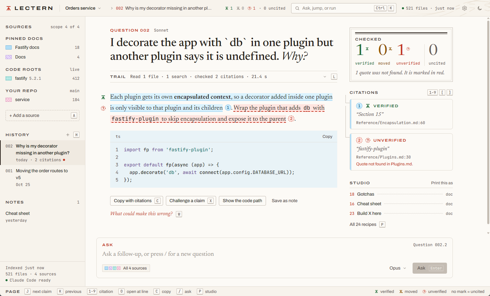

<h1 align="center">Lectern</h1>

<p align="center">
  A local notebook for developers. Pin the docs you trust, point it at your source folders, ask questions,<br>
  and every citation in the answer gets checked against the actual file before you see it.
</p>

<p align="center">
  <a href="#quick-start">Quick start</a> ·
  <a href="#your-first-notebook">First notebook</a> ·
  <a href="#settings">Settings</a> ·
  <a href="#use-it-from-claude-code-or-cursor-mcp">MCP</a> ·
  <a href="#cli">CLI</a> ·
  <a href="CHANGELOG.md">Changelog</a>
</p>

<p align="center">
  
  
  
</p>



## What it does that NotebookLM doesn't

- **Code roots.** A notebook holds pinned docs (the shelf) plus code roots, which are folders or git repos on your disk. The model can search and read any text file under a root while it answers, so it quotes the real source of the library you're using.
- **Checked citations.** Every `[n]` points at a file and a line range, and Lectern checks the quote is really there. Each one comes back verified, moved (found elsewhere in the file, with the new line), unverified or missing, and they get re-checked whenever you open an old conversation, so if the docs changed under you, it shows.
- **Studio.** 24 recipes that turn a notebook into a saved artifact (specs, code maps, a CLAUDE.md, flashcards, a diff review...) with the same citation checks.
- **MCP.** `lectern mcp` lets Claude Code or Cursor search your notebook for free and ask it questions while they work.

It all runs on your machine. The server only listens on 127.0.0.1.

## Quick start

Pick one.

### Desktop app (Windows)

```
git clone https://github.com/DizzyMii/lectern.git
cd lectern
npm install
npm run build:exe
```

That leaves two files in `dist/`:

| File | What it is |
|---|---|
| `Lectern Setup.exe` | Installs for your user, no admin needed. Starts in a couple of seconds. This is the one to hand to people. |
| `Lectern.exe` | Portable, runs from anywhere. It unpacks itself on every launch so it takes about 30 seconds to open. |

Neither needs Node on the machine it runs on. Neither is code signed yet either, so SmartScreen asks the first time (More info, Run anyway).

### npm

Needs Node 20 or newer.

```
npm install -g @dizzymii/lectern
lectern serve --open
```

`npx @dizzymii/lectern serve` works too if you don't want it installed. Either way it's on http://127.0.0.1:4317.

### From a clone

```
npm install
npm start        # the web app on http://127.0.0.1:4317
npm run app      # the same thing in the desktop window
```

[docs/SETUP.md](docs/SETUP.md) walks through a fresh machine step by step, including phone access over Tailscale and starting it at logon.

## Your first notebook

1. **Add an API key.** Click the cog in the top bar, paste a key from [console.anthropic.com](https://console.anthropic.com), Save. The engine label next to it turns green. (Already use Claude Code? Lectern can use your login instead, see [Engines](#engines).)
2. **Make a notebook.** First run walks you through it, or try the ready-made one:
   ```
   lectern example node-docs
   ```
   That pulls three pages of the Node.js 22 API docs into a new notebook.
3. **Add sources.** Press `A`. A page URL gets pinned as markdown, a folder or git repo becomes a code root the model can search.
4. **Ask.** Press `/`, type, Enter. Click any `[n]` to open the file at that line.

## How well it works

Measured on one notebook (NeoForge 1.21.1: 18 docs, 68 files, 3 code roots, about 350k tokens of pinned shelf). Yours will be different.

| | Result |
|---|---|
| 5 graded questions | 53 of 53 citations verified, 17.5 of 21 key facts |
| Fast ask through MCP | about 2 cents, 8 seconds |
| Deep ask | about 43 cents, 30 seconds |
| New conversation on Opus, shelf cached | about 30 cents |
| Cold shelf load | about $3 |

That $3 is the one to watch. The first ask per notebook and model loads the whole shelf into the cache and pays for it, after that it stays warm as long as you ask something within the hour (on the API engine that's a one-hour cache entry, which costs 2x input to write and a twentieth to read). Use fast mode (Haiku) for the "where is X" kind of lookups.

## Settings

The cog in the top bar (or the engine label, or `Settings` in the `Ctrl+K` palette). Everything saves to `settings.json` in the home folder and applies straight away, except the two marked restart.

| Setting | Env var | What it's for |
|---|---|---|
| Anthropic API key | `ANTHROPIC_API_KEY` | The default engine. Only ever shown back as its last four characters. |
| Workspace id | `ANTHROPIC_WORKSPACE_ID` | Only for a key made outside a workspace (starts with `wrkspc_`). Without it those keys get a 400. |
| Claude Code binary | `CLAUDE_BIN` | Path to `claude` when it isn't on PATH. Restart. |
| Projects folder | `LECTERN_PROJECTS_DIR` | Where the first-run screen looks for projects. Your home folder when empty. |
| Clone size cap (MB) | `LECTERN_CLONE_MAX_MB` | A git checkout over this gets deleted again. 1024 when empty. |
| Allow private URLs | `LECTERN_ALLOW_PRIVATE_URLS` | Lets Add URL fetch intranet and localhost pages. |
| Port | `PORT` | 4317 when empty. Restart. |

Each one is also an environment variable, and a value saved in Settings wins over the environment. Clear the field and the environment's value comes back. Over Tailscale the page can show settings but only the machine Lectern runs on can change them.

## Engines

**API key (default).** Lectern calls the Anthropic API directly and you pay per token on your own key.

**Your Claude Code login.** If you already use Claude Code, Lectern can drive `claude -p` headless on whatever account `claude` is logged into. Install it, run `claude` once to log in, make sure it's on your PATH. This is for your own personal use on your own machine (check Anthropic's terms for your plan before pointing anything shared at it). Lectern strips the API key from that process so it really does bill the login, and a hook keeps its Read, Grep and Glob inside the notebook and its code roots.

With both set up the API key wins. `--engine api` or `--engine claude-code` on the CLI picks one and errors out if it isn't set up. A follow-up stays on the engine its conversation started on.

## Use it from Claude Code or Cursor (MCP)

Install globally first so `lectern` is on your PATH.

**Claude Code:**

```sh
claude mcp add lectern --scope user -- lectern mcp
```

**Cursor**, in `~/.cursor/mcp.json`:

```json
{
  "mcpServers": {
    "lectern": { "command": "lectern", "args": ["mcp"] }
  }
}
```

`list_notebooks`, `search`, `read_source`, `verify`, `list_artifacts` and `get_artifact` never call a model and come back in well under a second. `ask` and `generate` do and cost money. The web server doesn't need to be running. Arguments and protocol details are in [docs/mcp.md](docs/mcp.md).

## CLI

```
lectern serve [--port n] [--open]
lectern ask <notebook> "<question>" [--json] [--fast | --deep] [--continue <conversationId>]
            [--model opus|sonnet|haiku] [--effort e] [--max-turns n] [--engine api|claude-code]
lectern mcp
lectern list [--json]
lectern show <notebook> <conversationId|artifactId> [--json]
lectern new <id> [--title t] [--dir folder]
lectern add <notebook> <url|path|git-url> [--name n] [--branch b] [--subdir d]
lectern example [name] [--dir folder] [--code]
lectern migrate <old app folder>
lectern --version | --help
```

- `--fast` is Haiku at low effort with at most 4 rounds, `--deep` is Opus at high effort with at most 12. Without either it's Opus with at most 12. A round is one model request, every batch of tool calls costs another, and hitting the cap gives an error that says so.
- `add` works out what you gave it. A git URL (or a plain github, gitlab or codeberg link) gets cloned as a code root, any other http URL is fetched as a doc, a folder becomes a code root and a file gets copied in.
- `show` re-checks the saved citations against the files as they are now.
- `example` with no name lists the ready-made notebooks. `neoforge` is the big one, add `--code` to also pull the NeoForge and GeckoLib sources.

The web app's HTTP API is internal and can change between versions, script against the CLI or MCP.

<details>
<summary><b>Studio recipes</b></summary>

<br>

Open Studio with `P`. Each recipe asks for a couple of inputs and saves an artifact into the notebook.

| Group | Recipes |
|---|---|
| Plan | Product requirements, Tech spec, Implementation plan, Decision record, Test plan |
| Visual | Code map, Concept map, Flow diagram, Sequence diagram, Dependency graph |
| Agent | CLAUDE.md, AGENTS.md, Agent skill, Agent quiz |
| Learn | Onboarding guide, Cheat sheet, Porting guide, Gotchas, Glossary, Flashcards |
| Code | Gap report, Diff review, How would I build..., Release notes |

Code map, CLAUDE.md, Glossary and Product requirements make a LOT of tool calls and are the likeliest to hit the 4-round cap in fast mode. Run those in deep.

</details>

<details>
<summary><b>Keyboard shortcuts</b></summary>

<br>

`?` opens the full sheet in the app.

| Key | Does |
|---|---|
| `Ctrl+K` | command palette |
| `/` | focus the composer |
| `N` or `Alt+N` | new conversation |
| `J` / `K` | next / previous claim |
| `1` to `9` | open citation n |
| `[` / `]` | previous / next citation |
| `O` | open the current citation in the source drawer at the line |
| `C` | copy the answer with citations |
| `X` | challenge the claim under the cursor |
| `W` | ask "what could make this wrong?" |
| `H` | focus history |
| `Shift+H` | toggle claim bands |
| `L` | toggle the trail log |
| `P` | Studio |
| `A` | add a source |
| `Ctrl+B` | toggle the rail |
| `Ctrl+1` / `2` / `3` | focus rail / page / margin |
| `Ctrl+Shift+F` | search the notebook |
| `Ctrl+Shift+L` | toggle theme |
| `Esc` | close the top layer, then clear the claim cursor |

Inside Studio artifacts, flashcards flip with `Space` and rate with the arrow keys, graphs zoom with `+` `-` `0`, sequence diagrams step with `J` / `K`, and `Ctrl+S` saves an edited file.

</details>

<details>
<summary><b>What leaves your machine</b></summary>

<br>

- **Your question, the pinned docs and whatever files the model reads** go to Anthropic, through the API or through Claude Code. The first ask in a conversation sends the whole shelf, follow-ups send the conversation so far, and tool calls send back the file contents the model asked for.
- **Adding a URL** fetches that page (user-agent `lectern/1.0`) and saves it as markdown. Loopback, private and link-local addresses are refused, redirects included, unless you turn on Allow private URLs.
- **Adding a git URL** runs `git clone --depth 1` (sparse when you give a subfolder). https:// or git@ only, symlinks come out as plain files, hooks and LFS downloads are off, and a checkout over the size cap gets deleted again.
- **`lectern example`** downloads that example's sources from GitHub.
- On the Claude Code engine, Claude Code's own telemetry settings apply to that process. Lectern leaves them alone.

That's the whole list. No telemetry, no update check, and the fonts and scripts are bundled so nothing loads from a CDN. Search, file reads, citation checks and the free MCP tools never touch the network. The page sends a Content-Security-Policy that blocks loads from any other host, so an answer can't smuggle in an image tag that phones home.

Everything under a code root can end up in front of the model. In a git repo Lectern indexes what `git ls-files` lists (so `.gitignore` applies), outside one it skips the usual build and dependency folders. Don't add a folder with secrets in it.

</details>

<details>
<summary><b>Where your stuff lives</b></summary>

<br>

A notebook is a folder with a `notebook.json` in it, anywhere on disk:

```
notebook.json     title, pinned docs, code roots
sources/          docs you added (fetched pages, copied files)
corpus/           git repos you added
conversations/    every conversation, as JSON
notes/            notes, as markdown
artifacts/        Studio output
```

Per-user state goes in the Lectern home folder: the notebook list (`registry.json`), cached base sessions (`bases.json`), `settings.json`, and the desktop app's window profile. It's picked in this order:

1. the `LECTERN_HOME` environment variable
2. `"home"` in `~/.lectern.json`, like `{"home": "D:/lectern-home"}`
3. `~/.lectern`

The config file is handy when your home drive is full. If you ran the old spike app, `lectern migrate <old app folder>` copies its registry and base sessions over.

</details>

## Limits and rough edges

- Every number above comes from one NeoForge notebook. I haven't measured anything else yet.
- I've only run it on Windows. macOS and Linux should work for the npm route, nobody has checked, and the desktop build is Windows only for now.
- The text file list leans toward what I use (Java, Kotlin, Gradle, JSON, JS, TS, Python, shaders, markdown). No Go, Rust or C yet, files with those extensions get skipped.
- Files over 2 MB count as missing for search, reads and citations.
- On the API engine a follow-up sends the earlier turns back whole, files the model read included, and most of that comes from cache. If you add a source or a code root mid-conversation it has to fall back to the answers as plain text, so the model forgets what it read and that follow-up re-pays the cache.
- The packaged desktop app can't be used as the CLI. Use `lectern` from npm or `node bin/lectern.mjs` for that.
- This is a release candidate, things will still move before 1.0.0.

## License

[PolyForm Shield 1.0.0](LICENSE). In plain words: use it, change it, run it at work, share it. You can't use it to build or sell a product that competes with Lectern. The full text in LICENSE is what actually counts.

Copyright 2026 Kade Heglin.
